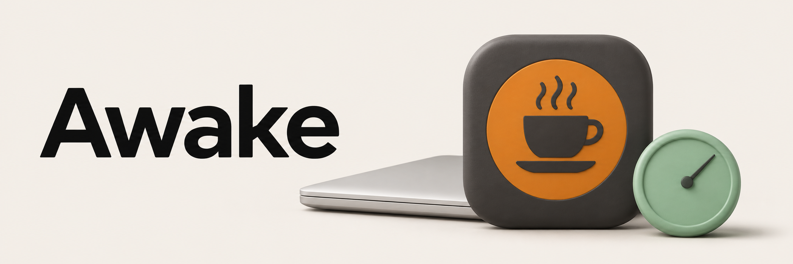
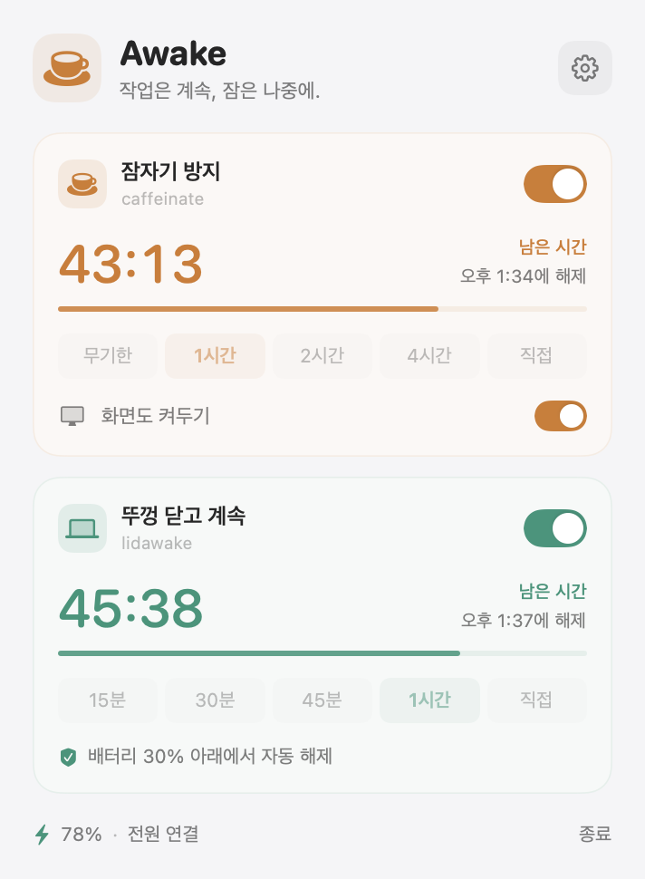
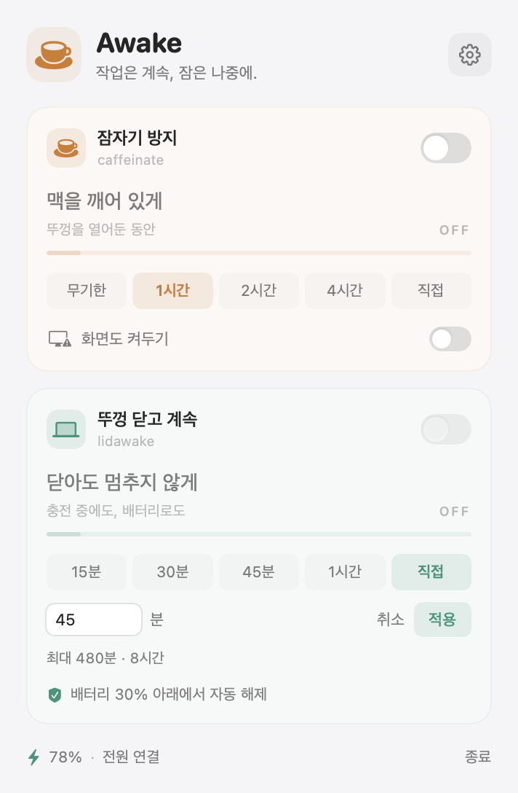
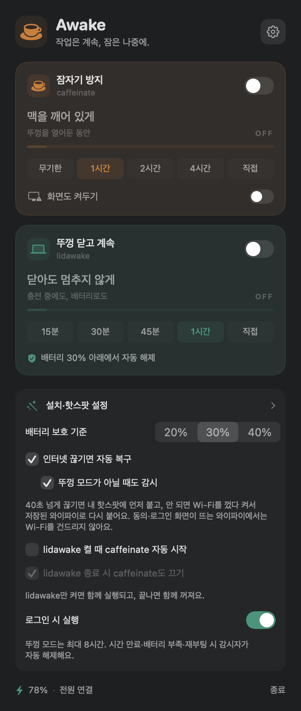
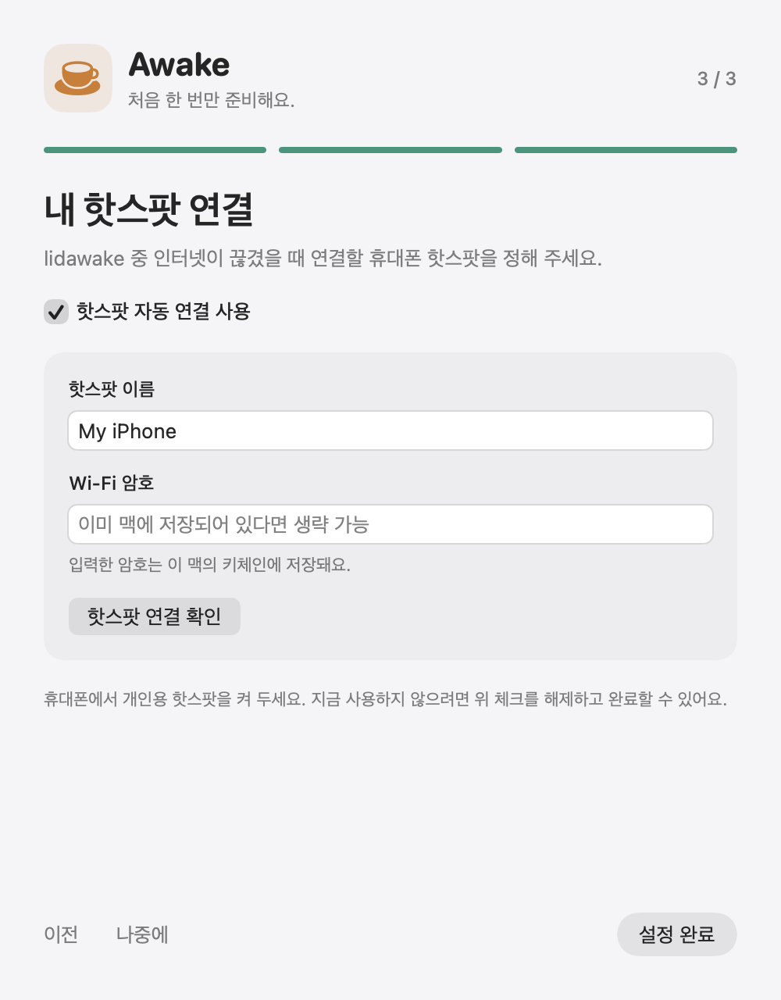

<p align="center">
  
</p>

# 작업은 계속, 잠은 나중에.
메뉴 막대에서 맥을 깨어 있게 하고, 뚜껑을 닫은 동안에도 작업을 이어가도록 설정하는 macOS 앱입니다. 필요한 시간과 배터리 보호 기준을 고르고, 인터넷이 끊기면 내 핫스팟으로 복구를 시도합니다.

<p>
  <a href="https://github.com/leeyekrj/awake/releases/latest"></a>
  
  
  <a href="LICENSE"></a>
</p>

**[다운로드](https://github.com/leeyekrj/awake/releases/latest)** · [화면 둘러보기](#화면-둘러보기) · [처음 설정](#처음-설정) · [문제 제보](https://github.com/leeyekrj/awake/issues)

<p align="center">
  
</p>

> 앱 화면은 배포본을 예시 상태로 렌더한 이미지입니다. 상단 커피·노트북 이미지는 소개용 그래픽입니다.

## 설치
macOS 14 이상, Apple Silicon·Intel Mac을 지원합니다. 터미널에서 아래 한 줄을 실행하세요. 빌드 도구는 필요 없습니다.
```bash
curl -fsSL https://raw.githubusercontent.com/leeyekrj/awake/main/install.sh | bash
```
GitHub Release에서 앱을 받아 SHA256·앱 식별자·버전·서명 무결성을 확인하고 `/Applications/Awake.app`에 설치합니다. 해당 폴더에 쓰기 권한이 없으면 `~/Applications/Awake.app`을 사용합니다. 이 명령은 **앱만 설치**하며, 관리자 도구 설치나 Wi-Fi 설정 변경은 앱의 설정 마법사에서 진행합니다.

현재 배포본은 ad-hoc 서명이며 **Apple 공증을 받지 않았습니다**. 실행이 차단되면 앱을 한 번 연 뒤 **시스템 설정 → 개인정보 보호 및 보안 → 그래도 열기**를 확인하세요. 회사 관리 기기에서는 조직 정책에 따라 설치가 제한될 수 있습니다.

직접 받으려면 [최신 릴리스](https://github.com/leeyekrj/awake/releases/latest)의 ZIP을 풀고 Awake.app을 응용 프로그램 폴더로 옮기세요.

설치 스크립트를 먼저 확인하려면:
```bash
curl -fsSL https://raw.githubusercontent.com/leeyekrj/awake/main/install.sh -o /tmp/awake-install.sh
less /tmp/awake-install.sh
bash /tmp/awake-install.sh
```

## 화면 둘러보기
### 켜두고 싶은 만큼만
잠자기 방지는 무기한·1시간·2시간·4시간 또는 직접 정한 시간을 사용합니다. ‘화면도 켜두기’를 켜면 해당 세션 동안 화면도 유지합니다. 앱이 종료되면 앱이 만든 전원 assertion은 해제됩니다.

### 뚜껑은 닫고, 시간은 정해두고
뚜껑 모드는 15분·30분·45분·1시간 또는 **최대 8시간**까지 직접 설정합니다. 배터리 보호 기준은 20·30·40% 중 고릅니다. 시스템 감시자가 시간 만료·배터리 부족·재부팅·만료 기록 없는 켜짐 상태를 확인해 자동 해제합니다. 배터리 하한에 따른 해제는 외부 전원을 연결하지 않았을 때 적용합니다.

<p align="center">
  
</p>

### 네트워크가 끊겨도 다시 연결되도록
40초 넘게 인터넷이 끊기면 저장한 핫스팟 연결을 먼저 시도하고, 연결하지 못하면 Wi-Fi를 껐다 켜서 macOS가 알려진 네트워크에 다시 연결하도록 합니다. 동의·로그인 페이지가 있는 Wi-Fi에서는 재시작하지 않습니다. 뚜껑이 닫힌 경우에는 핫스팟 연결만 시도합니다.

핫스팟이 검색 가능하고 휴대폰 데이터 연결이 동작해야 복구할 수 있습니다. 핫스팟을 설정하지 않았거나 기능을 끄면 자동 복구는 실행하지 않습니다. 설정에서 뚜껑 모드 밖의 상시 감시와 잠자기 방지 연동도 선택할 수 있습니다. 화면 자동 꺼짐이나 잠금의 시스템 설정은 변경하지 않습니다.

<p align="center">
  
</p>

## 처음 설정
설치한 앱을 열고 메뉴 막대의 커피잔을 누릅니다. **일반 잠자기 방지는 관리자 도구 없이 사용할 수 있습니다.** 뚜껑 모드를 쓰려면 설정 마법사에서 전용 도구의 실행 권한에 동의하고 macOS 관리자 인증 창에서 한 번 승인하세요. 앱에 관리자 암호를 입력하거나 저장하지 않습니다.

핫스팟 자동 복구를 쓰려면 각자의 핫스팟 이름과 필요한 Wi-Fi 암호를 입력합니다. 암호는 이 Mac의 키체인에 저장합니다. ‘핫스팟 연결 확인’은 실제 접속을 시도하므로 현재 네트워크가 바뀔 수 있습니다. 사용하지 않을 기능은 나중에 설정해도 됩니다.

<p align="center">
  
</p>

뚜껑 모드 설정은 root 소유의 전용 헬퍼와 1분 간격 LaunchDaemon을 설치합니다. 암호 없는 관리자 실행 예외는 **이 전용 헬퍼 하나**에만 부여하며, 헬퍼는 정해진 시간·배터리 기준의 뚜껑 모드와 해제 명령만 받습니다. 임의 셸 명령을 실행하는 도구는 아닙니다. 자동 복구는 사용자 LaunchAgent가 15초 간격으로 확인합니다.

## 업데이트와 제거
Awake를 메뉴에서 종료한 뒤 설치 명령을 다시 실행하면 됩니다. 앱이 켠 잠자기 방지와 뚜껑 모드는 종료할 때 해제되므로 진행 중인 작업이 끝난 다음 업데이트하세요. 기존 앱은 같은 폴더에 백업하고, 개인 설정은 유지합니다. 자동 업데이트는 없습니다.

관리자 도구를 설치했다면 앱을 지우기 전에 종료하고 아래 명령으로 제거하세요. 뚜껑 모드를 해제하고 Awake가 설치한 감시자·실행 예외를 제거합니다. 기존 별도 lidawake 설치는 유지합니다.
```bash
sudo /bin/bash /Applications/Awake.app/Contents/Resources/awake-uninstall.sh
```
다른 위치에 설치했다면 앱 경로를 바꿔 실행하세요. 네트워크 자동 복구는 앱 설정에서 먼저 끄고, 해당 사용자의 터미널에서 감시자를 제거한 뒤 앱을 삭제하세요.
```bash
launchctl bootout "gui/$(id -u)/io.theplato.paul.lidawake-netguard" 2>/dev/null || true
rm -f "$HOME/Library/LaunchAgents/io.theplato.paul.lidawake-netguard.plist"
``` 사용자 설정과 핫스팟 정보는 `~/Library/Application Support/Awake/`, 설정값은 `io.paul.awake` 환경설정에 남습니다. 앱만 삭제해도 관리자 감시자가 자동 제거되지는 않습니다.

## 데이터와 권한
잠자기 방지는 인터넷 연결이 필요 없습니다. 네트워크 자동 복구는 Apple·Google의 연결 확인 주소에 응답을 요청합니다. Awake 자체 분석 서버·계정·구독은 없습니다. 접근성·화면 기록 권한은 필요하지 않습니다. 로그인 시 실행은 사용자가 켜야 등록됩니다.

개인 핫스팟 이름·암호·설정·실행 기록은 소스나 배포본에 포함하지 않습니다. 핫스팟 이름 등은 로컬 로그에 남을 수 있으므로 문제 제보에 로그를 첨부할 때 내용을 확인하세요.

## 소스 빌드
Swift 6 이상이 포함된 Xcode Command Line Tools와 macOS 14 이상이 필요합니다.
```bash
git clone https://github.com/leeyekrj/awake.git
cd awake
bash scripts/build.sh
build/Awake.app/Contents/MacOS/Awake --self-test
python3 scripts/check-installer.py
python3 scripts/check-netguard.py
```
`bash scripts/package.sh`는 두 아키텍처의 앱과 키체인 도구를 묶어 `dist/`에 ZIP과 SHA256을 만듭니다. Apple Silicon에서 Intel 실행 검사를 하려면 Rosetta가 필요합니다. 실제 Intel 기기·macOS 14 기기·관리 기기의 첫 설치는 별도 검증 범위입니다.

## 라이선스
[MIT License](LICENSE). 외부 출처와 시스템 프레임워크 사용은 [라이선스 고지](THIRD_PARTY_NOTICES.md)를 확인하세요.
